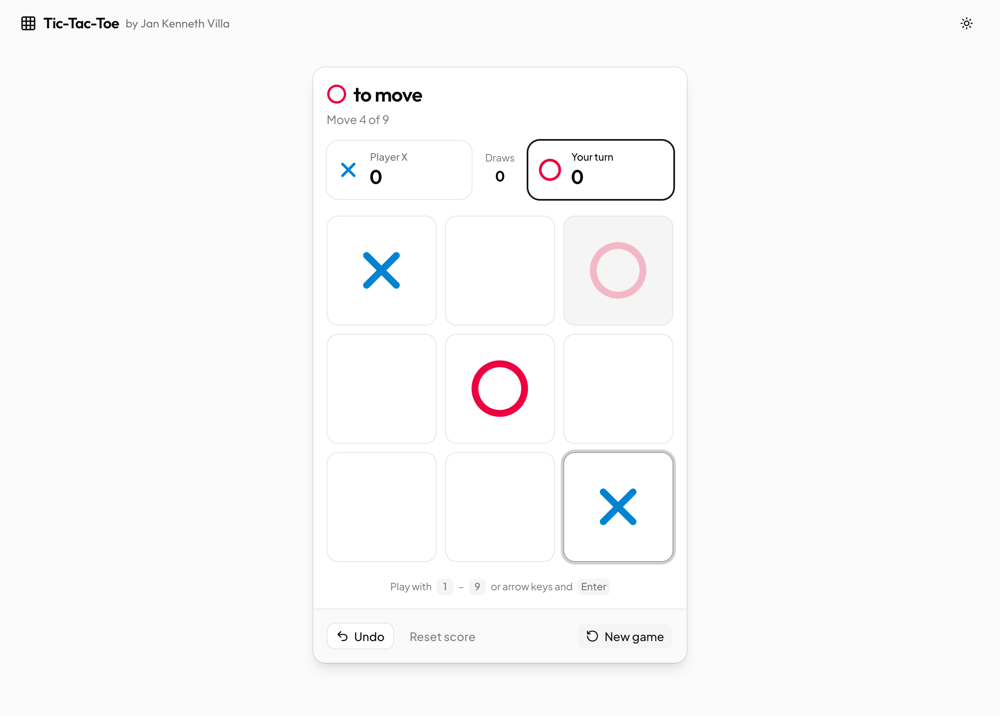
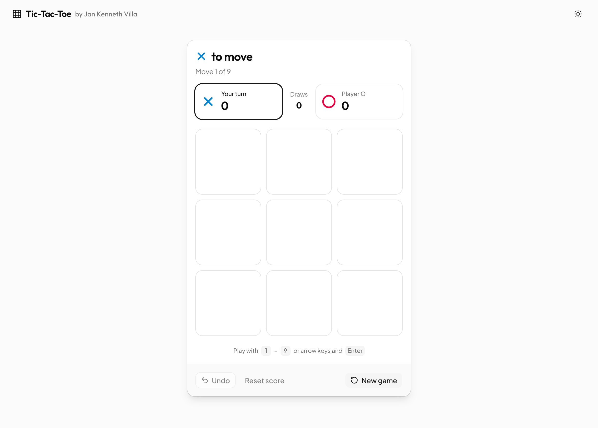
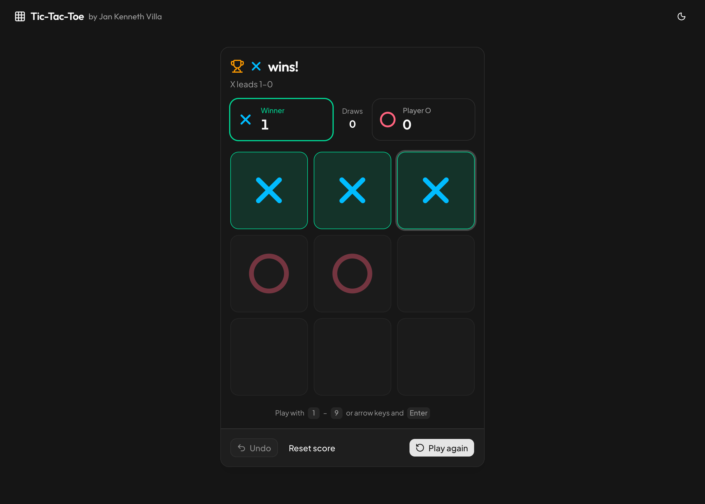
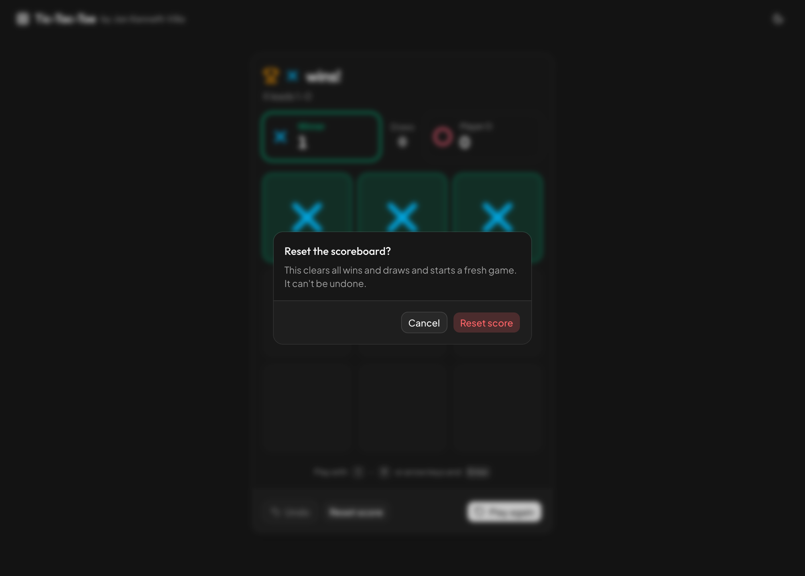
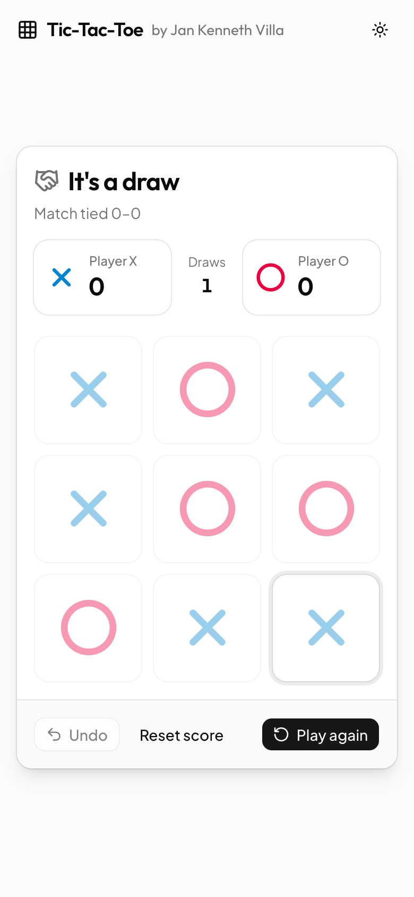

# tic-tac-toe-jkmv-demo

A polished two-player Tic-Tac-Toe game by **Jan Kenneth Villa (JKMV)**, built with **React 19**, **Next.js 16**, **Tailwind CSS 4** and **shadcn/ui**.



## Features

- **Two-player local play** – X and O take turns on the same device.
- **Live scoreboard** – wins and draws are tracked and saved in the browser, so the score survives a page reload.
- **Fair rotation** – the starting player alternates after every finished game.
- **Clear game state** – the header shows whose move it is, the winner (with the match score, e.g. *X leads 1–0*) or a draw; the winning line is highlighted.
- **Move preview** – hovering an empty square shows a faint preview of the mark you're about to place.
- **Undo** the last move, start a **new game**, or **reset the score** (with a confirmation dialog).
- **Keyboard friendly** – play with <kbd>1</kbd>–<kbd>9</kbd>, move around the board with the arrow keys and place with <kbd>Enter</kbd>/<kbd>Space</kbd>.
- **Light & dark mode** – follows your system setting, with a circular reveal animation when toggling.
- **Accessible** – screen-reader announcements for game status, labelled squares, and reduced-motion support.
- **Responsive** – works on phones, tablets and desktops.

## Screenshots

| New game | Winner (dark mode) |
| --- | --- |
|  |  |

| Reset score confirmation | Mobile – draw |
| --- | --- |
|  |  |

## Keyboard shortcuts

| Key | Action |
| --- | --- |
| <kbd>1</kbd> – <kbd>9</kbd> | Play a square (left to right, top to bottom) |
| Arrow keys | Move between squares |
| <kbd>Enter</kbd> / <kbd>Space</kbd> | Place a mark on the focused square |
| <kbd>U</kbd> or <kbd>Ctrl</kbd>/<kbd>⌘</kbd> + <kbd>Z</kbd> | Undo the last move |
| <kbd>N</kbd> | New game / play again |

## Tech stack

| Tool | Purpose |
| --- | --- |
| [Next.js 16](https://nextjs.org) (App Router) | Framework |
| [React 19](https://react.dev) | UI library |
| [TypeScript](https://www.typescriptlang.org) | Type safety |
| [Tailwind CSS 4](https://tailwindcss.com) | Styling |
| [shadcn/ui](https://ui.shadcn.com) (Base UI) | Button, Card, Tooltip, Kbd, Alert Dialog components |
| [next-themes](https://github.com/pacocoursey/next-themes) | Light/dark mode |
| [lucide-react](https://lucide.dev) | Icons |
| Outfit & Plus Jakarta Sans (via `next/font`) | Typography |

## Getting started

**Requirements:** Node.js 22 or newer.

```bash
git clone https://github.com/JanKenneth11/tic-tac-toe-jkmv-demo.git
cd tic-tac-toe-jkmv-demo
npm install
npm run dev
```

Open [http://localhost:3000](http://localhost:3000) to play.

### Scripts

| Command | Description |
| --- | --- |
| `npm run dev` | Start the development server |
| `npm run build` | Create a production build |
| `npm start` | Serve the production build |
| `npm run lint` | Run ESLint |

## Project structure

```
src/
├── app/
│   ├── globals.css         # Tailwind + shadcn theme tokens, fonts, theme transition
│   ├── layout.tsx          # Root layout, fonts, metadata, providers
│   └── page.tsx            # Header + game page
├── components/
│   ├── providers.tsx       # Theme + tooltip providers
│   ├── theme-toggle.tsx    # Light/dark toggle with circular reveal
│   ├── tic-tac-toe.tsx     # The game UI
│   └── ui/                 # shadcn/ui components
└── lib/
    ├── game.ts             # Board, winner and draw logic
    ├── score-store.ts      # Scoreboard persisted to localStorage
    └── utils.ts            # cn() class-name helper
docs/screenshots/           # README screenshots
```

## Author

**Jan Kenneth Villa (JKMV)** – [@JanKenneth11](https://github.com/JanKenneth11)
